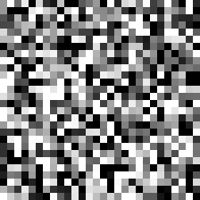
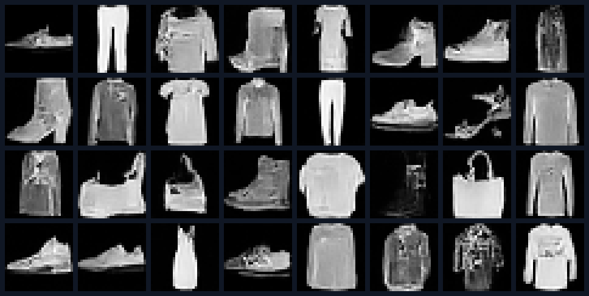
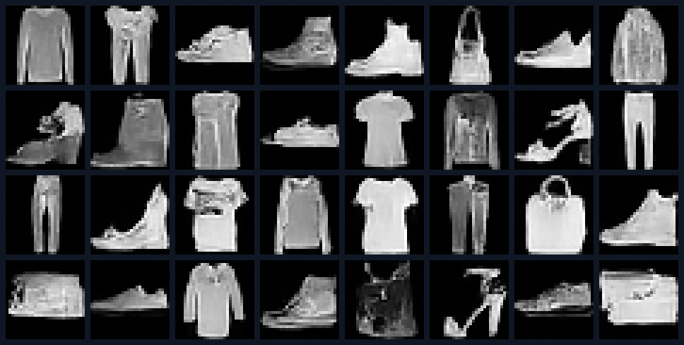
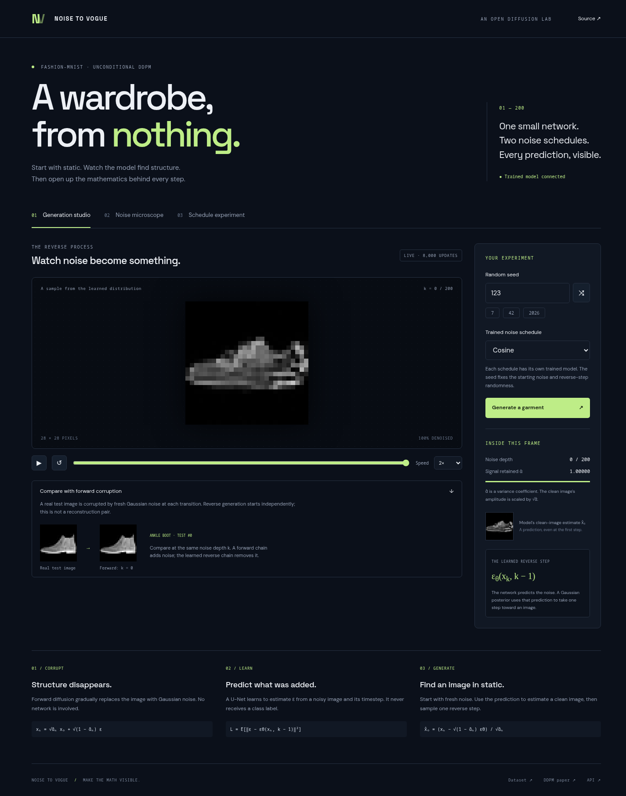

# Noise to Vogue

**A wardrobe, from nothing.** A small unconditional DDPM trained on Fashion-MNIST, with a viewer that explains the mathematics through actual model predictions.

[](https://github.com/rivindu02/noise-to-vogue/actions/workflows/test.yml)

## Watch noise become a garment

<table>
  <tr><th>Linear schedule</th><th>Cosine schedule</th></tr>
  <tr>
    <td align="center"></td>
    <td align="center"></td>
  </tr>
</table>

Actual trajectories from the trained EMA models after **8,000 updates each**. Both use sampling seed **42** and execute all **200 reverse transitions**.

## Results

Both schedules completed **8,000 updates** and were evaluated on **1,024 held-out examples**. Paired controls, the automated CPU test suite, and the live API smoke checks passed. See [measured results](results/REPORT.md), [full metrics](results/metrics.json), [test output](results/test-output.txt), and [smoke checks](results/smoke-test.json). Desktop and mobile browser checks passed; see [browser QA](results/browser-qa.json) and [screenshots](results/screenshots/).

## Generated samples

<table>
  <tr><th>Linear · 8,000 updates</th><th>Cosine · 8,000 updates</th></tr>
  <tr>
    <td width="50%"></td>
    <td width="50%"></td>
  </tr>
</table>

**32 samples per schedule · sampling seed 42 · 28 × 28 pixels.** See the [measured comparison](results/REPORT.md) for the evaluation protocol and limits.

## What you can explore

- **Generation studio:** arbitrary seed selection, repeatable ancestral sampling, playback controls, frame scrubbing, and the model's clean-image estimate at each saved timestep.
- **Forward versus reverse:** a real held-out image's forward Markov corruption alongside independently initialized reverse generation, aligned by noise depth.
- **Noise microscope:** original image, corrupted image, actual injected noise, predicted noise, estimated clean image, MSE, and numerical coefficients in the reconstruction equation.
- **Schedule experiment:** separately trained linear and cosine schedules, training curves, held-out noise MSE, signal-matched measurements with standard errors, sample grids, and downloadable experiment records.

There is no class conditioning or guidance in this version. The model never receives labels.



The generation studio exposes each saved reverse-diffusion frame and the model's clean-image estimate.

More views: [Noise microscope](results/screenshots/desktop-microscope.png) · [Schedule experiment](results/screenshots/desktop-experiment.png) · [Mobile layout](results/screenshots/mobile-generation.png).

## Setup and run

Python 3.10+ is required. A CUDA-enabled PyTorch installation is recommended for training; CPU inference is supported. From the repository root:

```bash
python3 -m venv .venv
source .venv/bin/activate
# Install the appropriate PyTorch build for your machine first if necessary.
pip install -e '.[test]'
python -m pytest -q
python -m noise_to_vogue.prepare
```

The dataset downloader verifies the original Fashion-MNIST gzip files against their published MD5 checksums and parses IDX files directly. No torchvision or Diffusers dependency is needed.

Train a controlled pair on two available GPUs:

```bash
GPU_LINEAR=0 GPU_COSINE=1 bash scripts/train_pair.sh --steps 8000
```

For a single GPU, run the models sequentially:

```bash
python -m noise_to_vogue.train --schedule linear --device cuda --steps 8000
python -m noise_to_vogue.train --schedule cosine --device cuda --steps 8000
```

Each run uses all 60,000 training images, 200 diffusion timesteps, batch size 128, AdamW at 0.0002, and an EMA decay of 0.995. A small three-resolution U-Net predicts Gaussian noise. Each model sees the same initial weights, data order, sampled timesteps, and noise draws. The only changed training variable is the schedule. The last incomplete data batch is dropped each epoch, identically in both runs.

Checkpoints are atomically replaced every 1,000 optimizer updates and at the end. To resume, use the same configuration with `--resume`; the optimizer, gradient scaler, data cursor, data permutation, noise generator, and order generator are restored. The total update budget can be extended explicitly.

```bash
python -m noise_to_vogue.train --schedule linear --steps 8000 --resume
python -m noise_to_vogue.evaluate --samples 1024
bash scripts/serve.sh
```

Open **http://127.0.0.1:7860**. The viewer uses CPU inference by default. To use CUDA inference:

```bash
CUDA_VISIBLE_DEVICES=0 NTV_DEVICE=cuda bash scripts/serve.sh
```

The API serves committed export artifacts for demo seeds **7, 42, and 2026** when present. Other seeds run the loaded model. The evaluation script also exports compact EMA weights into `models/`, so a completed checkout supports arbitrary live seeds without keeping optimizer checkpoints. Missing checkpoints produce an explicit unavailable state rather than simulated model output.

## Running the experiment

The experiment runner installs dependencies, tests, trains both schedules, evaluates and saves the validation results:

```bash
bash scripts/run_experiment.sh
```

It uses GPUs 0 and 1 by default. Set `GPU_LINEAR`, `GPU_COSINE`, or `TRAIN_STEPS` to change those settings. Check GPU availability before starting. Data, virtual environments, logs and full optimizer checkpoints are ignored by Git; compact inference weights and measured outputs are versioned.

## The mathematics you see

We label image noise depth as **k = 0…T**. k = 0 is clean; the U-Net's zero-based timestep input for depth k is k − 1. Define αₖ = 1 − βₖ and ᾱₖ = ∏ᵢ₌₁ᵏ αᵢ.

The forward marginal used to construct a training example is

```text
ε ~ N(0, I)
xₖ = sqrt(ᾱₖ) x₀ + sqrt(1 − ᾱₖ) ε
L = E[mean_pixels((ε − εθ(xₖ, k − 1))²)]
```

The clean estimate is

```text
x̂₀ = (xₖ − sqrt(1 − ᾱₖ) εθ(xₖ, k − 1)) / sqrt(ᾱₖ)
```

Reverse sampling clips x̂₀ to [−1, 1] and uses the Gaussian posterior mean

```text
μ = βₖ sqrt(ᾱₖ₋₁) / (1 − ᾱₖ) · x̂₀
  + (1 − ᾱₖ₋₁) sqrt(αₖ) / (1 − ᾱₖ) · xₖ
β̃ₖ = βₖ (1 − ᾱₖ₋₁) / (1 − ᾱₖ)
xₖ₋₁ = μ + sqrt(β̃ₖ) z              for k > 1
x₀ = μ                              for k = 1
```

All T reverse transitions are evaluated; the viewer saves a subset of frames for playback. Reducing playback frames does not skip model steps.

The forward animation uses fresh Gaussian noise at each **Markov transition**, `xₖ = sqrt(1−βₖ) xₖ₋₁ + sqrt(βₖ) z`. The microscope instead uses the closed-form forward marginal at a selected k, holding its injected noise fixed when the seed is fixed. These are different but consistent uses of the forward process.

Ground-truth noise is available only for deliberately corrupted held-out images. Unconditional reverse generation has no known original image or ground-truth noise. Forward and reverse animations are not paired reconstruction trajectories.

Actual and predicted noise use the same signed color scale: **−3 to +3 standard deviations**, blue to orange. Grayscale image displays clip to [−1, 1]. Metrics are computed from raw tensors; both raw and clipped clean reconstruction MSE are recorded. Noise-prediction MSE uses unscaled noise values.

## A controlled schedule experiment

The linear schedule scales the original 1,000-step DDPM β endpoints by 1000/T. The cosine schedule uses the squared-cosine cumulative signal curve with offset 0.008 and a maximum β of 0.999. At the default T = 200, both endpoints are near pure noise.

Evaluation selects 1,024 test images with seed 31415 and draws paired Gaussian noise with seed 27182. Both models are evaluated on the same images and noise at specified depths. A separate comparison picks each schedule's nearest timestep to target ᾱ values of 0.99, 0.9, 0.5, 0.1, and 0.01; achieved ᾱ and timestep are reported so the approximation is visible. The standard error is calculated across held-out examples.

The report records data checksums, evaluation-index hash, initial-weight hashes, checkpoint and compact-weight SHA-256 hashes, parameter counts, training histories, elapsed time, environment versions, and verification of the paired controls. Changing only an inference schedule on an existing model is not this experiment.

**Limits:** one paired training seed does not measure training uncertainty. Same-depth MSE values can correspond to different signal-to-noise ratios. Training loss is not directly comparable across different noise distributions. Lower noise MSE does not prove better generation quality. This project makes no FID, class-coverage, or statistical-superiority claim. GPU numerical reproducibility is intended within the recorded hardware/software configuration; exact outputs can differ across devices or PyTorch versions.

## Verification

```bash
python -m pytest -q
node --input-type=module --check < web/app.js
node --input-type=module --check < web/charts.js
# Requires the completed pair and evaluation artifacts:
python scripts/smoke_test.py
```

Full-checkpoint evidence in [training verification](results/training-verification.json) also confirms 8,000 applied optimizer updates per model and matching data/noise RNG progress.

Tests cover schedule validity, oracle noise inversion, the posterior-mean formula, the deterministic final reverse step, fixed-seed sampling, network gradients, IDX validation, checksum failures, exact CPU training resume, request validation, missing-checkpoint behavior, exported-demo serving, live inference, and agreement between microscope and batch evaluation metrics. Tests use tiny synthetic data and do not download Fashion-MNIST. Their outputs do not imply sample quality. GitHub Actions runs the CPU suite on each push and pull request.

## Browser verification

The recorded run uses a separate headless Brave browser through Chrome DevTools Protocol. It checks generation presets and custom seeds, repeatability, playback, keyboard tabs, the noise microscope, real charts/downloads, error presentation, reduced motion, and layouts at 1440, 390 and 320 pixels. Screenshots were inspected as well. Expected 503 responses during error-state checks are recorded separately from unexpected browser errors. This does not claim assistive technology testing.

To repeat with a Chromium-based browser already running with `--remote-debugging-port=19222`, and Node with built-in `fetch` and `WebSocket` support:

```bash
NTV_URL=http://127.0.0.1:7860 NTV_QA_OUTPUT=/tmp/noise-to-vogue-qa node scripts/browser_qa.mjs
```

## Layout

```text
noise_to_vogue/   Model, schedules, dataset, training, evaluation, API
web/             Responsive HTML/CSS/JS viewer; no frontend build required
scripts/         Viewer launch, paired training, experiment runner, live smoke checks
tests/           Mathematical, training, rendering, and API tests
checkpoints/     Full resumable checkpoints (ignored)
models/          Compact EMA inference weights (produced by evaluation)
results/         Measured metrics, samples, GIFs, demos, report, test evidence
```

## References

- [Fashion-MNIST](https://github.com/zalandoresearch/fashion-mnist) — original dataset, split and file checksums. Dataset licensing remains with its authors.
- [Denoising Diffusion Probabilistic Models](https://arxiv.org/abs/2006.11239), Ho et al. — noise prediction and ancestral sampling.
- [Improved Denoising Diffusion Probabilistic Models](https://arxiv.org/abs/2102.09672), Nichol and Dhariwal — cosine schedule reference; this project uses fixed variance.
- [Diffusers basic training tutorial](https://huggingface.co/docs/diffusers/tutorials/basic_training) — reference training workflow. This implementation uses explicit PyTorch equations to make them inspectable.

Code is MIT licensed. Model weights and dataset-derived visualizations are generated from Fashion-MNIST; retain dataset attribution when sharing them.
